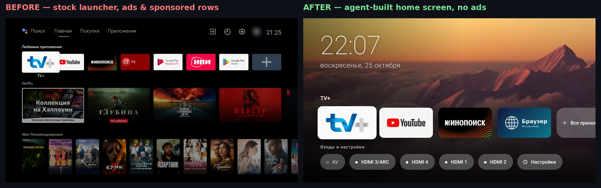

# 📺✨ Android TV AI Glow-Up

### Let an AI agent turn a slow, ad-stuffed Android TV into a fast, clean, Google-TV-style smart TV.
**No root. No new hardware. Just `adb`, Wi-Fi, and a well-briefed AI agent.**

`debloat` · `ad-free` · `custom launcher` · `system-wide adblock` · `one-command rollback`

---

## Why this exists

Millions of perfectly good TVs from 2018–2021 run **Android TV 9/10** with 2 GB of RAM. Over the years they get:

- 🐌 **slower** — dozens of preinstalled services, trackers and "recommendation" apps eat the RAM;
- 📢 **louder** — sponsored rows, promo banners and viewing-tracking (ACR) services fill the home screen;
- 🧊 **abandoned** — no new OS, no Google TV redesign, no Gemini.

You don't need a new TV. A modern AI coding agent (Claude Code, Cursor, Codex, Gemini CLI, Copilot agent mode, …) can **audit, clean, harden and even redesign** the TV for you over `adb` — while asking your permission before every change and keeping a rollback for everything.

This repo is **not a script**. It's a set of **battle-tested prompts and agent context** so *your* agent can do it safely on *your* TV model.

---

## 📊 What changed (example run)

> Example device: 2020 Sony BRAVIA, Android TV 9, 2 GB RAM, 8 GB storage. Your numbers will differ by model.

| Metric | Before | After | Δ |
|---|---|---|---|
| Free RAM after a clean boot (`MemAvailable`) | ~593 MB | ~789 MB | **+33 %** |
| Background bloat / ad / tracking packages active | 31 | 0 (disabled, *not* uninstalled) | **−31** |
| Sponsored rows & promo banners on home | 4+ rows | 0 | **gone** |
| Ad & tracker domains (all apps) | allowed | blocked via encrypted DNS | **system-wide** |
| Menu animations | 1.0× | instant | **snappier UI** |
| Stock launcher visible after power-on | ~11 s | 0 frames | **seamless boot** |
| Home screen | stock grid + ads | clock, date, rotating photo backgrounds, favorites row, HDMI inputs | **Google-TV-style** |
| Ad-free web browser for the remote | — | installed, adblock on | **new** |
| Rollback | — | one command | **100 % reversible** |

The agent also wrote and ran its **own test suite on the TV** (launch every app, D-pad navigation, inputs, reboot persistence, crash-loop and DNS-outage drills) and fixed the bugs it found.

---

## 🤖 What an AI agent can actually do here

| Capability | How |
|---|---|
| **Find the TV** on your network | mDNS + port-5555 scan, then `adb connect` |
| **Audit** every package and explain it in plain language | `pm list packages`, `dumpsys`, usage stats |
| **Debloat safely** | `pm disable-user --user 0` only — never uninstall system apps |
| **Measure** before/after | `/proc/meminfo`, `dumpsys meminfo`, boot timelines from `logcat` |
| **Kill ads system-wide** | Private DNS (DNS-over-TLS) to an ad-blocking resolver + a watchdog that falls back if it goes down |
| **Redesign the home screen** | write, build and sideload its own lightweight launcher APK (clock, date, photo slideshow, app row, inputs row) |
| **Beat the "stock launcher always comes back" problem** | accessibility-service HOME-key handling + boot cover, with crash-loop fail-safes |
| **Drive the TV UI itself** | `screencap` to *see* the screen, `input keyevent` / virtual input device to press remote buttons |
| **Generate art** | AI-generated 16:9 wallpapers for the home screen |
| **QA its own work** | automated on-device tests + reboots, reads crash buffers, fixes regressions |
| **Keep it reversible** | change log + one-command undo for every step |

---

## 🚀 Quick start

1. **On the TV:** Settings → Device Preferences → About → click **Build** 7×. Then in **Developer options** enable **USB debugging** (and **Network debugging** if present).
2. **Same network:** TV and computer on the same LAN (Ethernet or Wi-Fi).
3. **Open your AI agent** with shell access on the computer (Claude Code, Cursor agent, Codex CLI, Gemini CLI, …).
4. **Paste the master prompt:** [`prompts/00-master-prompt.md`](prompts/00-master-prompt.md)
5. Press **Allow** on the TV when the debugging prompt appears, then approve each step the agent proposes.

Prefer smaller steps? Use the phase prompts:

| # | Prompt | Result |
|---|---|---|
| 1 | [`01-audit-and-debloat.md`](prompts/01-audit-and-debloat.md) | Audit table, safe debloat, faster UI, before/after RAM |
| 2 | [`02-custom-home-screen.md`](prompts/02-custom-home-screen.md) | Your own Google-TV-style launcher, no root |
| 3 | [`03-adblock-and-browser.md`](prompts/03-adblock-and-browser.md) | System-wide ad blocking + remote-friendly ad-free browser |
| 4 | [`04-qa-and-hardening.md`](prompts/04-qa-and-hardening.md) | On-device test suite, fail-safes, reboot checks |

Give your agent the extra context in [`skills/android-tv-makeover/SKILL.md`](skills/android-tv-makeover/SKILL.md) — it lists the non-obvious pitfalls that otherwise cost hours.

---

## 🛡️ Safety rules baked into the prompts

- **Audit first, change nothing** until you approve a list.
- **Disable, never uninstall** system packages (`pm disable-user --user 0`), so everything is restorable.
- **Every change is logged** with a **single undo command**.
- **Ask before** anything that reboots, downloads, or changes network/DNS.
- **Fail-safes**: if the custom home screen crashes repeatedly, HOME falls back to the stock launcher; if the ad-blocking DNS is unreachable, the TV switches back to normal DNS automatically.

> ⚠️ You are modifying your own device. Read what your agent proposes before approving. Some apps (e.g. a few streaming apps) may complain about DNS ad blocking — the undo is one command.

---

## 💡 Push it further — ideas for your agent

- 🌤️ Weather + calendar next to the clock; "Continue watching" row from apps' Watch Next data
- 🗣️ LLM voice search: remote mic → speech-to-text → LLM → open the right app or title
- 🖼️ Ambient mode with your own photo library or daily AI-generated art
- 🔌 HDMI-CEC automations: TV on → soundbar on, console detected → switch input + game mode
- 🧹 Monthly maintenance as a scheduled agent task: clear caches, check updates, report RAM
- 👨‍👩‍👧 Per-profile home screens and simple parental limits
- 📦 Self-hosted media (Jellyfin/Plex) row on the home screen
- 📈 Tiny on-device dashboard: RAM, storage, network, DNS status

PRs with prompts for other brands (TCL, Philips, Xiaomi, Hisense, Nvidia Shield, Chromecast) are very welcome.

---

## 🇷🇺 Кратко по-русски

Старый Android TV тормозит и показывает рекламу? Дайте ИИ-агенту `adb` и промпты из этого репозитория: он сделает аудит, безопасно отключит мусор (без удаления системных приложений), включит блокировку рекламы на весь ТВ, поставит браузер без рекламы и напишет вам собственный красивый главный экран в стиле Google TV — с часами, датой и меняющимися фото. Каждое изменение логируется и откатывается одной командой. Начните с [`prompts/00-master-prompt.md`](prompts/00-master-prompt.md).

---

**If this saved your TV from the landfill, ⭐ the repo so others can find it.**

`android-tv` `smart-tv` `debloat` `adb` `ai-agent` `claude-code` `adblock` `launcher` `google-tv` `sony-bravia` `prompt-engineering`

